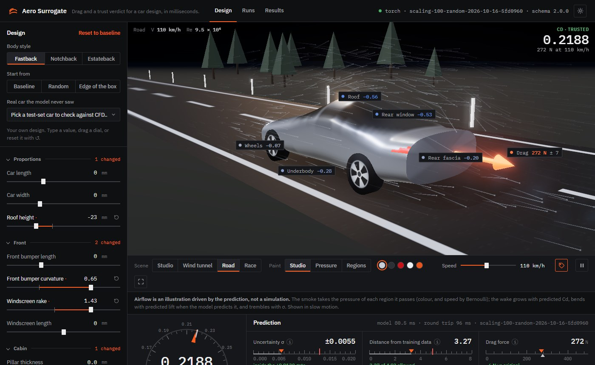
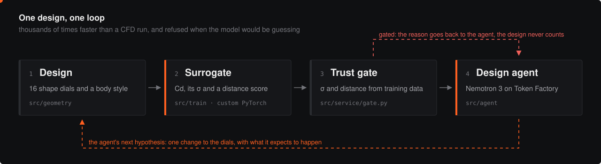

<p align="center"></p>

<p align="center">
  <a href="LICENSE"></a>
  
  
</p>

**Aero Surrogate helps explore vehicle design parameters before the next CFD verification.** A neural drag model scores candidates, NVIDIA Nemotron proposes changes through Nebius Token Factory, and a domain gate rejects unsupported parameter combinations. Each hypothesis is checked against the observed surrogate result in an inspectable logbook.

**This is a local-run release.** The complete application, with the real trained models, starts on your machine with Docker in three commands ([Quick start](#quick-start)). The checksummed model bundle is attached to the [v1.0.0 release](https://github.com/Nijjea1/Aero-Surrogate/releases/tag/v1.0.0). There is no hosted demo. Demo video: _link added after upload_.

See the [submission description](docs/submission/submission.md), the [completion report](docs/submission/COMPLETION.md) or the [documentation index](docs/README.md).

## Quick start

You need [Docker](https://docs.docker.com/get-docker/) with Compose, Git and Python 3 (the installer uses only the standard library; use `python3` on macOS/Linux).

```bash
git clone https://github.com/Nijjea1/Aero-Surrogate.git && cd Aero-Surrogate
python scripts/install_artifacts.py --archive https://github.com/Nijjea1/Aero-Surrogate/releases/download/v1.0.0/aero-surrogate-models.zip --sha256 70b2829ae2a5e0f1a8bc82f7d1f2321cad1d8fba62ff3f191c4a53b399834a93 --destination .
docker compose up --build
```

Open <http://localhost:5173>. The first build downloads CPU PyTorch and takes a few minutes. The installer verifies the archive and every file in it against the published hash before writing anything. `http://localhost:8000/health` should report `"synthetic": false` and checkpoint `49e5a8b1…706a`.

| Without a Token Factory key | With your own key |
|---|---|
| Designer: all sixteen parameters, predicted Cd, sigma and the domain gate; 3D car; experimental pressure view | Everything on the left |
| Runs: the fifteen historical matched Nemotron, CMA-ES and random-search runs with full logbooks | Start live Nemotron Super/Nano runs from the Runs page and cancel them |
| Results: complete independent evaluation | Spend recorded in a persistent ledger |

To enable live runs, create `.env` containing `NEBIUS_API_KEY=<your key>` (never commit it) and run `docker compose up -d` again. Without a key, starting a run is refused with a clear message and nothing is spent. A 25-evaluation Super run cost about $0.03 in our tests; per-run, daily and lifetime application caps apply (defaults $0.10, $1.00 and $5.00, see [the API runbook](src/service/DEPLOY.md#6-environment-variables)). Run history and the spend ledger live in the `aero-surrogate_data` Docker volume and survive restarts. `docker compose down` stops everything; add `-v` only if you want to erase that history.

## What works

- **Designer:** sixteen DrivAerNet morph deltas across fastback, notchback and estateback bodies. Predict Cd, its sigma and a domain-screening verdict.
- **Agent:** Nemotron Super or Nano proposes one or two changes, calls the surrogate, receives gate feedback and updates its search. Numeric constraints are enforced in code. It currently receives scalar Cd feedback, not the separate pressure endpoint.
- **Logbook and comparison:** inspect hypotheses, observed changes, rejections and best-trusted curves. Compare historical matched Nemotron, CMA-ES and random-search runs.
- **Experimental pressure view:** a separate custom DoMINO-inspired PyTorch model predicts surface Cp on the approximate viewer mesh. Calibration and orientation on generated geometry are not independently established. It does not provide operational lift or wall shear.

<p align="center"></p>

The displayed vehicle is an approximate visualisation of the parameter choices, not an ANSA morph or the original CFD mesh. Smoke is illustrative, not a learned velocity field. Race and energy comparisons are explanatory simulations using predicted Cd and viewer-estimated frontal area; they are not vehicle-performance validation.

## How it works

<p align="center"></p>

| Component | Implementation |
|---|---|
| Scalar surrogate | Custom heteroscedastic PyTorch MLP, 237,186 parameters; sixteen morph deltas plus three body-style indicators; trained on 4,165 CFD-labelled DrivAerNet designs |
| Domain gate | Predicted Cd sigma and Mahalanobis distance; checkpoint distance threshold calibrated on held-out validation inputs; passing is not proof of physical accuracy |
| Design agent | NVIDIA Nemotron Super/Nano on Nebius Token Factory, typed tools, measured-effect memory, numeric constraints and application budget guards |
| API | FastAPI scalar/field endpoints, start/poll/cancel runs, persistent logbook, checkpoint identity and output provenance |
| Evaluation | Independent held-out scalar grading, simple references, interval coverage, domain probes and matched search protocol |
| UI | ES modules and three.js; designer, illustrative wind tunnel/race, Runs and Results pages; dynamic Python mesh endpoint |

Both surrogates are custom PyTorch implementations. NVIDIA DoMINO research informed the field architecture; this release does not claim a PhysicsNeMo runtime, pretrained DoMINO fine-tuning, H100 training or executed Serverless Jobs.

## Results

<p align="center"></p>

<!-- results:start -->
| Metric | Surrogate | Reference |
|---|---:|---:|
| Held-out R-squared | **0.8750** | Linear 0.8352 |
| Mean absolute Cd error | **0.00616** | |
| Test designs | **625** | |
| R-squared with notchback held out | **0.479** | Linear 0.280 |

By body style, held-out R-squared: estateback 0.805, fastback 0.796, notchback 0.866.

- **Intervals:** nominal 90% coverage is 86.56% on held-out labels; error bars under-cover.
- **Domain screening:** distance false alarms 0.32% on ordinary test designs; 100% of sampled jointly extreme corners flagged.
- **Category generalisation:** the separate evaluation-only checkpoint holds out an entire body style. Style-indicator novelty helps the detector; it does not demonstrate aerodynamic novelty detection.
- **Surface pressure:** Cp R-squared 0.508, MAE 0.14554 on 5 held-out DrivAerML cars (500,000 stored query cells). Generated viewer geometry remains unvalidated.
- **Field reference:** pooled nearest-training-point R-squared 0.691, MAE 0.10251; this reference beats the field network. It averages eight neighbours from pooled training-car points in position/normal space.
- **Field intervals:** 1-sigma coverage 79.94% versus nominal 68.3%; over-coverage on stored CFD arrays, not generated geometry.
- **Pressure-only drag:** per-car MAE 0.02184, mean absolute relative error 8.57% over stored query cells. Viscous drag is excluded; this is not full native CFD surface quadrature.
- **Data scaling:** 5 separately trained subset checkpoints, 146–2,915 training designs, R-squared 0.778–0.879 on a fixed test split. The scaling checkpoints do not replace the serving checkpoint.

> Final independent evaluation, 27 October 2026. Generated by `src/eval/harness.py`; artifact identities are recorded in the metric file.
<!-- results:end -->

The sigma head under-covers held-out labels and barely ranks individual errors. The distance check screens unfamiliar parameter combinations; explicit body-style indicators explain much of held-out-style detection. Neither mechanism guarantees aerodynamic correctness. Solver coefficient variation is not treated as a hard ceiling on attainable R-squared.

### The agent against the optimisers

<!-- bench:start -->
| Method | Runs | Median predicted Cd change | Best run | Best found at (median) | Gated (median) |
|---|---:|---:|---:|---:|---:|
| Nemotron Super | 5 | −3.88% | −4.49% | evaluation 21 | 0 |
| CMA-ES | 5 | −3.84% | −4.53% | evaluation 17 | 0 |
| Random search | 5 | −2.79% | −4.13% | evaluation 10 | 1 |

Fastback, 25 evaluations each, the same start, the same surrogate and the same gate. Lower is better. These historical experiments measure predicted Cd, not CFD-validated improvements. Nemotron and CMA-ES medians are comparable in this small experiment; equal calls do not mean equal time or cost.
<!-- bench:end -->

These are **surrogate-predicted Cd changes**, not new CFD-validated improvements. Five runs from one starting point do not establish broad search superiority. Equal evaluation count does not mean equal elapsed time or cost, and an individual candidate's sigma is not an error bar on its improvement.

Published files: [scalar metrics](web/results/metrics.json), [matched benchmark](web/results/benchmark.json). The generator `python docs/readme/build.py` keeps these tables and graphics aligned with those files. See [evaluation instructions](src/eval/README.md).

## Run without Docker

Python 3.13 is the tested version. The Linux containers in the [Quick start](#quick-start) were verified from a fresh clone ([compose evidence](docs/submission/evidence/compose-verification.json)); a fresh Windows/Python 3.13 CPU installation also passed dependency checks, tests and real-model HTTP wiring ([environment evidence](docs/submission/evidence/clean-environment.json)).

```powershell
# Windows PowerShell
python -m venv .venv
.\.venv\Scripts\Activate.ps1
python -m pip install torch --index-url https://download.pytorch.org/whl/cpu
python -m pip install -r requirements.txt
```

```bash
# macOS / Linux
python3 -m venv .venv
source .venv/bin/activate
python -m pip install torch --index-url https://download.pytorch.org/whl/cpu
python -m pip install -r requirements.txt
```

Install the model bundle with the same `install_artifacts.py` command as in the Quick start. The team can rebuild that ZIP from qualified artifacts with `python scripts/package_release.py --include-fields`. Alternatively train the scalar locally:

```powershell
python -m src.data.drivaernet --fetch
python -m src.train.train --config configs/drivaernet.yaml
$env:AERO_CHECKPOINT="runs/drivaernet-random/best.pt"
python -m uvicorn src.service.app:app --port 8000
```

In another shell:

```powershell
.\.venv\Scripts\Activate.ps1
python web/serve.py
```

Open `http://localhost:5173`. Check `/health` at `http://localhost:8000/health`: `synthetic` must be false and the checkpoint hash must match the intended artifact. Without `AERO_CHECKPOINT`, the service deliberately starts the labelled synthetic test fixture; those numbers are not aerodynamic evidence. Configuring an invalid checkpoint fails startup rather than falling back.

For optional pressure inference, configure `AERO_FIELD_CHECKPOINT` to the verified fields-v1 artifact before starting the API. No field data or weights are fetched by the UI. [API integration](src/service/INTEGRATION.md) documents its separate provenance and limitations.

### Run a real agent

Copy `.env.example` to a local `.env` and provide `NEBIUS_API_KEY`. Never commit credentials. A live run spends Token Factory credit; check the configured per-run and lifetime application limits first.

```powershell
python -m src.agent.designer --model super --iterations 25
```

The Runs page can start public runs, display progress and cancel a run using its cancellation token. Constraints are explicit rules such as `A_Car_Roof_Height >= 0`; arbitrary natural-language requirements are not automatically parsed. The scalar model's `pressure_summary` is empty, so current agent runs are Cd-guided.

### Test and reproduce

```powershell
python -m pytest tests -q
python -m src.service.qualify --checkpoint runs/drivaernet-random/best.pt --references runs/handover/scalar_reference.json --out runs/service-qualification.json
```

The final local suite passed 1,065 tests with two expected skips. Tests that use synthetic fixtures do not establish physical model accuracy. The [completion report](docs/submission/COMPLETION.md) separates numerical parity, independent grading and browser checks; the [documentation index](docs/README.md) links the current guides.

## Hosting (optional)

This release is not publicly hosted. To host it, the [API guide](src/service/DEPLOY.md) and [web guide](web/DEPLOY.md) describe the same two CPU containers behind HTTPS on one small VM. A static host alone is insufficient because the viewer needs `/api/mesh`. Keep one API worker, persist logs and spend accounting, and verify real model identity on the host.

Token Factory is the demonstrated Nebius service. AI Cloud is a possible hosting option; no AI Cloud deployment is claimed here.

## NVIDIA and Nebius

| Technology | Demonstrated use |
|---|---|
| NVIDIA Nemotron 3 Super and Nano | Real typed tool calls and multi-step design runs, with observed-result logbooks |
| Nebius Token Factory | Runtime model inference for those runs; saved token usage, latency and application spend accounting |
| NVIDIA DoMINO research | Architectural inspiration for the separate experimental surface-pressure model |

## Data, attribution and licences

Our code is [MIT licensed](LICENSE). Third-party data retains its own terms; MIT does not relicense it.

- **DrivAerNet**, Mohamed Elrefaie and collaborators: [dataset/code source](https://github.com/Mohamedelrefaie/DrivAerNet), **CC BY-NC 4.0**, non-commercial. This release's scalar work uses 4,165 tabular designs, not the full DrivAerNet++ mesh corpus.
- **DrivAerML**, Neil Ashton and collaborators: [author dataset card](https://huggingface.co/datasets/neashton/drivaerml), **CC BY-SA 4.0**. The experimental field model's training manifest records twenty training, five validation and five test cars. Redistributed samples and derivatives need their own attribution/terms.
- Model hashes, provenance and distribution notes travel with the release bundle. Dataset licences and any applicable artifact terms remain distinct from the source-code licence.

## Team

Avneet Nijjer / Pranoy / Paramveer

Built for the Nebius x NVIDIA Global AI Hackathon, **Best Apps and Agents**. [Submission materials](docs/submission/submission.md) include the final description, limitations and technology mapping.
