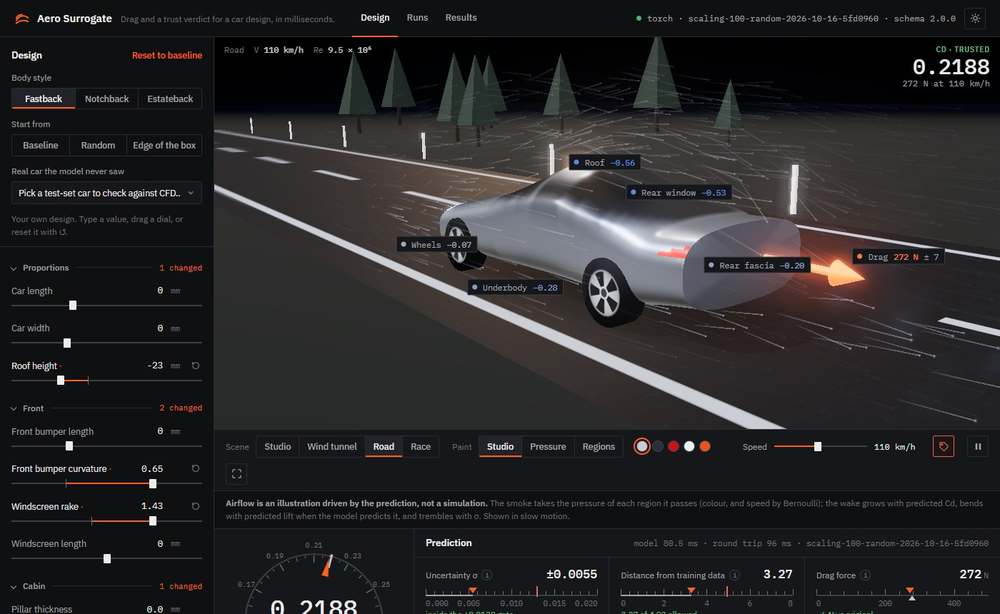
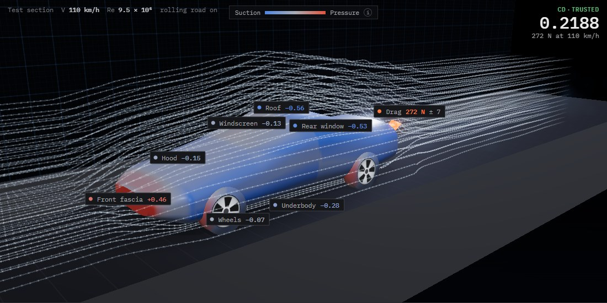
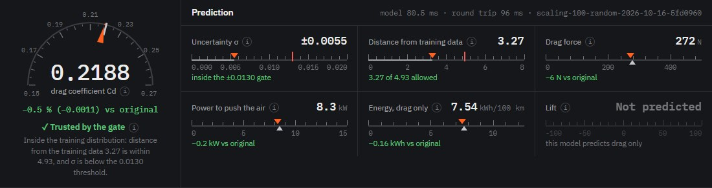
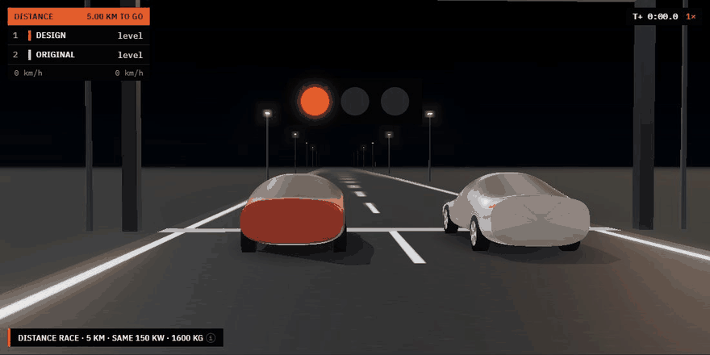
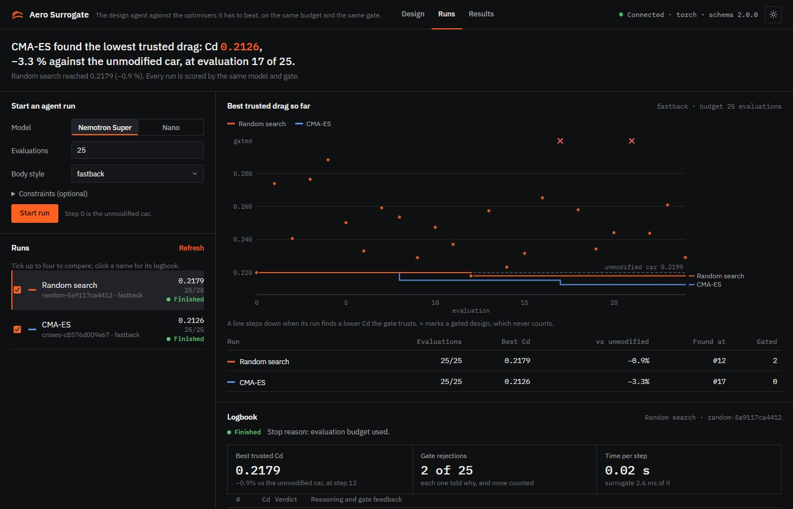
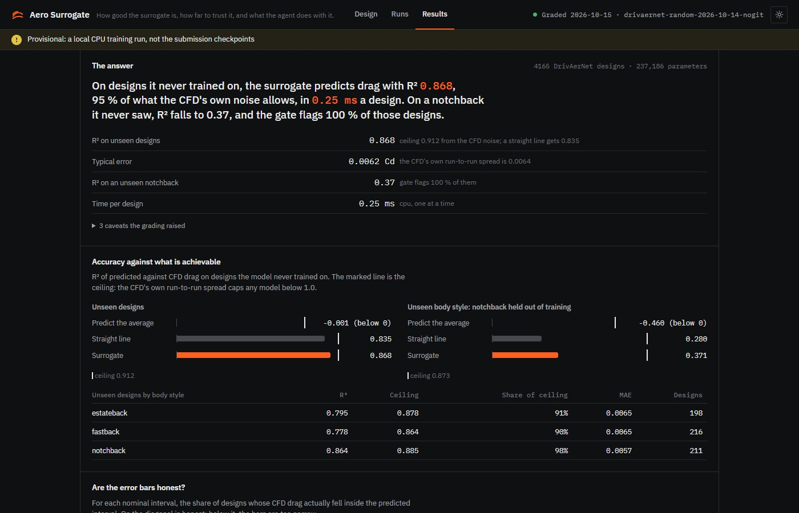
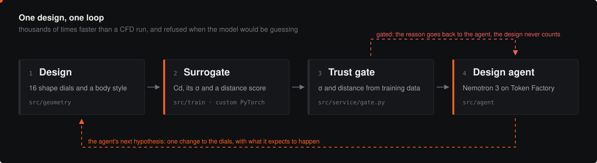

<p align="center">
  
</p>

<p align="center">
  <a href="https://nebiusglobalaihackathon.devpost.com/"></a>
  
  
  
  
  
</p>

<p align="center">
  <a href="#what-it-does">What it does</a> ·
  <a href="#see-it">See it</a> ·
  <a href="#how-it-works">How it works</a> ·
  <a href="#the-trust-gate">The trust gate</a> ·
  <a href="#results">Results</a> ·
  <a href="#run-it">Run it</a> ·
  <a href="#nvidia-and-nebius">NVIDIA and Nebius</a> ·
  <a href="#team">Team</a>
</p>

---

## What it does

A CFD run tells you the drag of one car shape, and it takes hours. That is
why a person tries a handful of designs, and why automated search in this
space mostly stays in papers.

**Aero Surrogate replaces the CFD call with a neural surrogate that answers
in a quarter of a millisecond, then lets a Nemotron 3 agent design with it.**
The part that makes this safe to automate is the **trust gate**. Every
prediction carries its own uncertainty and a distance from the designs the
model learned from. When either is too large, the prediction is refused with
the reason before the agent can optimise into a region where the model is
only guessing.

- **Designer.** Sixteen shape dials on the DrivAer fastback, notchback or
  estateback body, with Cd, its σ and the trust verdict on every move. The
  car is rendered in 3D with smoke that follows the prediction.
- **Design agent.** Nemotron 3 proposes one change at a time, states what it
  expects, and is told what actually happened. Every step lands in a logbook
  that is checked against the measured result, not the model's own claim.
- **Honest grading.** An independent evaluation harness grades every
  checkpoint against the ceiling set by the CFD's own noise. It checks
  whether the error bars are calibrated, tests a body style held out of
  training, and runs the agent against CMA-ES and random search on the
  same budget and the same gate.

<p align="center">
  
</p>

## See it

<p align="center">
  
</p>

The designer. Every pin on the car is a region's mean pressure coefficient.
The stage tag gives Cd with its verdict and the drag in newtons at the chosen
speed. Below it, a needle gauge brackets the original car, and ruled scales
place σ and the distance score against the gate's red lines.

<table>
  <tr>
    <td width="50%"></td>
    <td width="50%"></td>
  </tr>
  <tr>
    <td><b>Wind tunnel.</b> A test section with a measuring grid and a rolling road. The smoke speeds up where the model predicts suction and slows at the stagnation point.</td>
    <td><b>Instrument cluster.</b> The two numbers the gate reads, each against its limit, then drag, power and energy against the original car.</td>
  </tr>
</table>

### The race

<p align="center">
  
</p>

Your design against the original body, with the same engine, mass, tyres
and grip. Only the predicted drag (Cd × frontal area) differs. Three modes
are integrated from the same equation of motion:

- **Distance**, from 0.4 to 100 km, with a slow-motion photo finish at the line.
- **Top speed**, where engine power meets drag plus rolling resistance.
- **Coast-down**, with the engine off from a chosen speed.

A few percent of drag is invisible in a 1 km sprint (about 0.02 s), so the
race lets you go long enough to see it. Long races compress time
automatically, and the assumptions are printed under every result.

<table>
  <tr>
    <td width="50%"></td>
    <td width="50%"></td>
  </tr>
  <tr>
    <td><b>Runs.</b> Start or cancel an agent run, compare it with the optimisers on one chart, and read the logbook step by step.</td>
    <td><b>Results.</b> Every graded number, each against what is achievable, with the caveats the grading raised.</td>
  </tr>
</table>

## How it works

<p align="center">
  
</p>

| Part | What it is | Where |
|---|---|---|
| **Geometry** | Sixteen morph parameters of the DrivAerNet body (deltas from the baseline car) plus the body style, turned into a watertight mesh and its frontal area. The same mesh feeds the 3D view and the surface-pressure model. | `src/geometry` |
| **Surrogate, stage 1** | A heteroscedastic MLP (about 237k parameters) trained on 4,165 DrivAerNet designs with CFD drag. It predicts Cd and its own σ. A Mahalanobis detector fitted on the training designs scores how unusual a shape is. | `src/train`, `configs/drivaernet.yaml` |
| **Surrogate, stage 2** | A surface-pressure model after NVIDIA's DoMINO, scaled to a laptop GPU. A global point-cloud encoder and multi-scale local neighbourhoods (k = 8, 32, 128) feed a Fourier-lifted decoder. It is trained on DrivAerML LES surfaces with an integral-drag consistency term. | `src/train/field_model.py`, `configs/fields.yaml` |
| **Service** | FastAPI: `/evaluate`, `/fields` (per-face Cp on the exact mesh the viewer draws, bound by its hash), agent runs with start, poll and cancel, rate limits, spend reservation, and a Docker image. | `src/service` |
| **Trust gate** | Refuses a prediction whose σ is above 0.013 or whose distance score is above the checkpoint's calibrated threshold, and returns the reason to the caller. | `src/service/gate.py` |
| **Design agent** | Nemotron 3 Super or Nano on Nebius Token Factory, with typed tool calls. It makes one hypothesis per step, has a budget and a spend cap, and every claim is judged against the observed score. | `src/agent` |
| **Baselines** | Random search and CMA-ES on the same budget, start, gate and comparison protocol as the agent. | `src/optim` |
| **Evaluation** | An independent grader: noise ceiling, references, calibration, a held-out body style, OOD detection, data scaling, surface pressure and the agent-against-optimiser benchmark. | `src/eval` |
| **Web UI** | Plain ES modules and three.js, with no build step. The designer, wind tunnel, road, race, Runs and Results pages. | `web/` |

## The trust gate

An optimiser will walk straight into whatever corner of design space the
model happens to be most wrong about, because that is where its predictions
look best. A surrogate is only useful to an agent if it can tell when it is
guessing.

The gate checks two things, and both are needed:

- **σ, the model's own error bar,** catches noisy predictions near the data.
  On its own it barely notices a shape the model has never seen. When the
  notchback body is held out of training, σ alone separates those designs
  from ordinary ones with an AUROC of only about 0.56.
- **The distance from the training designs** (Mahalanobis, calibrated on the
  training set) is what catches those. It flags every held-out notchback
  while flagging well under 1% of ordinary test designs.

A gated design is shown greyed out on the stage. In a race it runs under an
"untrusted prediction" banner. For the agent, the reason comes back as the
tool result and the design never counts toward its best.

## Results

<!-- results:start -->
| | Surrogate | Straight line | Ceiling |
|---|---:|---:|---:|
| R² on unseen designs | **0.868** | 0.835 | 0.912 |
| R² on an unseen notchback | **0.37** | 0.28 | 0.873 |
| Typical error (Cd) | **0.0062** | | CFD spread 0.0064 |

By body style, unseen designs: estateback R² 0.795, fastback R² 0.778, notchback R² 0.864.

- **Error bars:** the 1σ band holds 64% of designs (68% is honest), so they run a little narrow.
- **Trust gate:** with the notchback body style held out of training, the distance check flags 100% of those designs and 0.3% of ordinary ones. σ alone would rank them with an AUROC of only 0.56, which is why the gate checks both.
- **More data:** retrained on 146 to 2,915 designs, R² rises from 0.78 to 0.88; a straight line levels off near 0.84.
- **Surface pressure:** graded by `src/eval/fields.py`; the numbers appear here once the stage-2 checkpoint is graded.

> Provisional: a local CPU training run, not the submission checkpoints. Graded by `src/eval/harness.py` into `web/results/metrics.json`.
<!-- results:end -->

### The agent against the optimisers

<!-- bench:start -->
| Method | Runs | Median drag change | Best run | Best found at (median) | Gated (median) |
|---|---:|---:|---:|---:|---:|
| CMA-ES | 5 | −4.88% | −5.37% | evaluation 16 | 0 |
| Random search | 5 | −4.00% | −4.77% | evaluation 12 | 1 |

Fastback, 25 evaluations each, the same start, the same surrogate and the same gate. Lower is better. The live Nemotron runs join this table once they are recorded.
<!-- bench:end -->

Everything here is regenerated from the graded files by
`python docs/readme/build.py`. Grading is `python -m src.eval.harness`,
`python -m src.eval.scaling`, `python -m src.eval.fields` and
`python -m src.eval.benchmark`; see [`src/eval/README.md`](src/eval/README.md).

## Run it

```bash
python -m venv .venv
source .venv/bin/activate            # Windows: .venv\Scripts\activate
pip install -r requirements.txt
python -m src.data.drivaernet --fetch   # the public DrivAerNet parameter table (small)

uvicorn src.service.app:app --port 8000   # the synthetic stub until you give it a checkpoint
python web/serve.py                       # http://localhost:5173
```

<details>
<summary><b>Train and serve a real surrogate</b></summary>

```bash
python -m src.train.train --config configs/drivaernet.yaml                    # stage 1, minutes on a CPU
python -m src.train.train --config configs/drivaernet.yaml --split category   # one body style held out
AERO_CHECKPOINT=runs/drivaernet-random/best.pt uvicorn src.service.app:app --port 8000
```

Stage 2 needs the DrivAerML surfaces; see [`data/README.md`](data/README.md)
and [`configs/fields.yaml`](configs/fields.yaml).
</details>

<details>
<summary><b>Run the agent and the optimisers</b></summary>

```bash
python -m src.agent.provider --smoke                         # one cheap Nano call, needs NEBIUS_API_KEY
python -m src.agent.designer --model super --iterations 25   # a live Nemotron run
python -m src.optim.baseline --method cmaes --iterations 25
python -m src.optim.baseline --method random --iterations 25
python -m src.eval.benchmark --baseline-seeds 5 --iterations 25 --body-style fastback
```

Runs appear on the Runs page as they go. The agent's spend is reserved and
capped per run and per day. See [`src/service/README.md`](src/service/README.md).
</details>

<details>
<summary><b>Deploy</b></summary>

Two containers on one Nebius AI Cloud CPU VM behind Caddy: the API
([`src/service/DEPLOY.md`](src/service/DEPLOY.md)) and the web UI with its
mesh endpoint ([`web/DEPLOY.md`](web/DEPLOY.md)). No GPU is needed to serve.
</details>

```bash
pytest -q        # about 930 tests, no network, no GPU
```

## NVIDIA and Nebius

| | How it is used |
|---|---|
| **NVIDIA Nemotron 3** | The design agent: Nemotron 3 Super (120B-A12B) for runs, Nano (30B-A3B) for cheap checks and smoke tests. It uses typed tool calls, one hypothesis per step, and every claim is judged against the measured result. |
| **Nebius Token Factory** | Serves Nemotron to the agent, with a spend ledger that reserves cost before each call and caps every run. |
| **Nebius AI Cloud** | Hosting: the API and the web UI as two small CPU containers on one VM behind Caddy ([API](src/service/DEPLOY.md), [web](web/DEPLOY.md)). |
| **NVIDIA research** | The surface-pressure model follows DoMINO's design (a global geometry encoding plus multi-scale local neighbourhoods), and the DrivAerML preparation follows PhysicsNeMo's external-aerodynamics examples. |

Both surrogates are deliberately small. Stage 1 trains in minutes on a CPU, and
stage 2 is sized for a single laptop-class GPU, so serving needs no GPU at all.

## Data and licence

- **DrivAerNet** (stage 1): 4,165 parametric designs with CFD drag.
  CC BY-NC 4.0, **non-commercial**.
- **DrivAerML** (stage 2): high-fidelity LES surface fields; see
  [`data/README.md`](data/README.md).
- **Code:** MIT. See [LICENSE](LICENSE).
st.

<p align="center"></p>
